# Application workflow

How Water Reminder works: the processes it runs, what happens at startup, how reminders are
scheduled and paused, how the UI stays in sync, and how installers are built and released.

- [1. Architecture](#1-architecture)
- [2. Startup](#2-startup)
- [3. Settings storage](#3-settings-storage)
- [4. Start with system](#4-start-with-system)
- [5. Scheduler and pause](#5-scheduler-and-pause)
- [6. Reminder popup](#6-reminder-popup)
- [7. Settings window and IPC](#7-settings-window-and-ipc)
- [8. Tray menu](#8-tray-menu)
- [9. Sleep, wake and quit](#9-sleep-wake-and-quit)
- [10. Install and uninstall](#10-install-and-uninstall)
- [11. Build and release pipeline](#11-build-and-release-pipeline)

---

## 1. Architecture

Water Reminder is an Electron tray app with no visible main window. Everything that holds state
or touches the operating system runs in the **main process** (`main.js`). The two windows are
plain HTML pages (**renderers**) that cannot use Node.js. They talk to the main process only
through a narrow bridge, `window.api`, defined in `preload.js`.

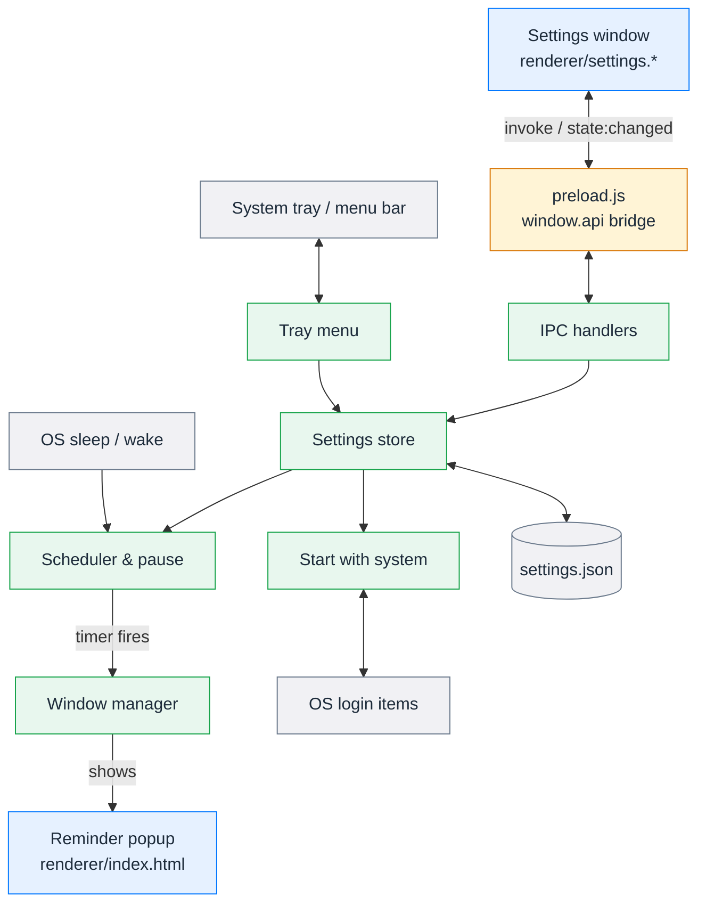

Blue: renderer pages · yellow: preload bridge · green: main process · grey: operating system.

| Part              | File(s)                                  | Responsibility                                                     |
| ----------------- | ---------------------------------------- | ------------------------------------------------------------------ |
| Settings store    | `main.js`                                | Load, validate and save `settings.json`                            |
| Start with system | `main.js`                                | Register or remove the login item on Windows, macOS and Linux      |
| Scheduler         | `main.js`                                | One timer for the next reminder, or one timer for the end of a pause |
| Windows           | `main.js`                                | Create the popup and the single settings window                    |
| Tray              | `main.js`                                | Context menu, tooltip with the current status                      |
| Bridge            | `preload.js`                             | Exposes `getState`, `setSettings`, `pause`, `resume`, `testAlert`, `onStateChanged` |
| Popup UI          | `renderer/index.html`, `popup.js`, `style.css` | Animation, message, optional sound                         |
| Settings UI       | `renderer/settings.*`                    | Interval, presets, pause/resume, toggles                           |

`getState()` in the main process is the **single source of truth** for the UI. It returns the
settings plus derived values (paused or not, status text, next reminder time) and the presets
and limits, so the renderers never hardcode any of them.

---

## 2. Startup

Only one copy of the app can run. A second launch (for example, double-clicking the shortcut
again) doesn't start a new process; it opens the settings window of the one already running.

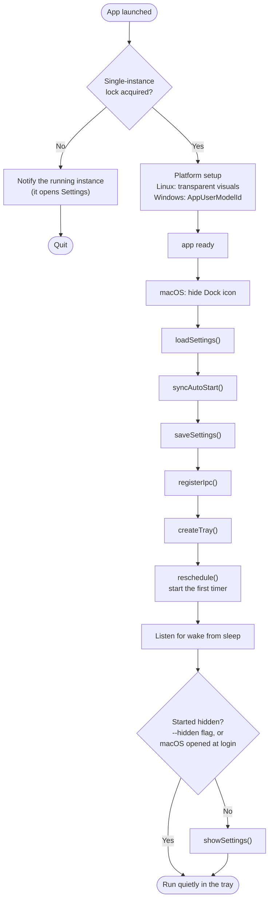

When the OS launches the app at login, it passes `--hidden` (or, on macOS, the app checks
`wasOpenedAtLogin`), so it goes straight to the tray. Launching it yourself opens the settings
window.

---

## 3. Settings storage

Settings live in a plain JSON file in the app's user-data folder:

| System  | Location                                                     |
| ------- | ------------------------------------------------------------ |
| Windows | `%APPDATA%\Water Reminder\settings.json`                     |
| Linux   | `~/.config/Water Reminder/settings.json`                     |
| macOS   | `~/Library/Application Support/Water Reminder/settings.json` |

| Key               | Default | Meaning                                                                         |
| ----------------- | ------- | ------------------------------------------------------------------------------- |
| `intervalMinutes` | `30`    | Minutes between reminders, always clamped to 1–480                              |
| `autoStart`       | `true`  | Start with system                                                               |
| `soundEnabled`    | `true`  | Play a sound with the popup                                                     |
| `pausedUntil`     | `null`  | `null` = active, a timestamp in ms = paused until then, `"indefinite"` = paused until resumed |

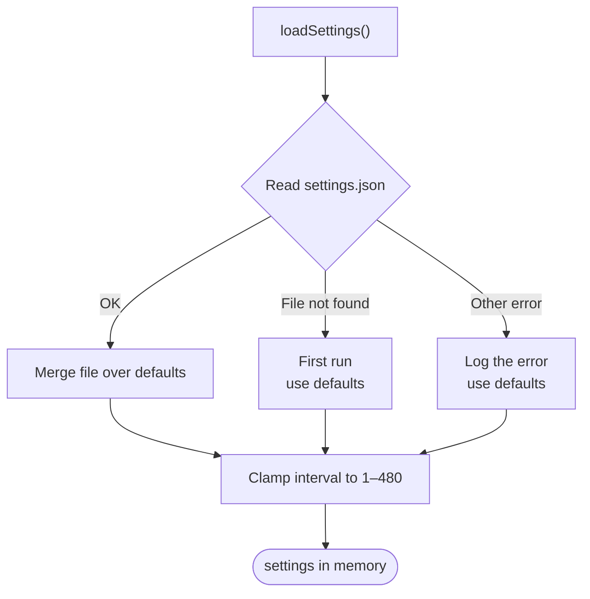

Every change goes through `updateSettings(patch)`. It applies only the keys present in the
patch, coerces their types, saves the file, then either reschedules (if the interval changed)
or just refreshes the UI. Read and write errors are logged and never crash the app.

---

## 4. Start with system

Each OS has its own login-item mechanism. The app only registers itself when it's
**packaged**: in development the executable is Electron itself, which must never be added
to startup.

| System  | Mechanism                                                              |
| ------- | ---------------------------------------------------------------------- |
| Windows | `HKCU\…\CurrentVersion\Run` value named `WaterReminder`, with `--hidden` |
| macOS   | Login Items, opened hidden                                             |
| Linux   | `~/.config/autostart/water-reminder.desktop` with `--hidden` (uses the AppImage path when running from an AppImage) |

At startup, the app **reads the OS state instead of overwriting it**. If you turned it off in
Task Manager, System Settings or by deleting the `.desktop` file, the app accepts that and
updates its own setting.

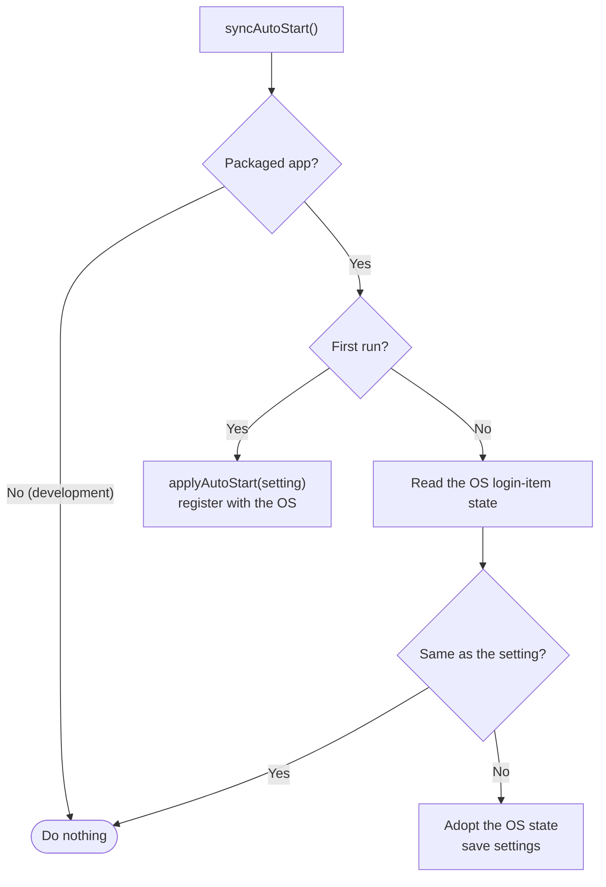

Turning the toggle off **removes** the entry entirely (not just marks it disabled), so the app
disappears from Task Manager → Startup apps.

---

## 5. Scheduler and pause

At most **one timer** is running at a time: either the timer for the next reminder, or the
timer for the end of a pause. `reschedule()` always clears both before deciding which one to
start, so calling it repeatedly is safe.

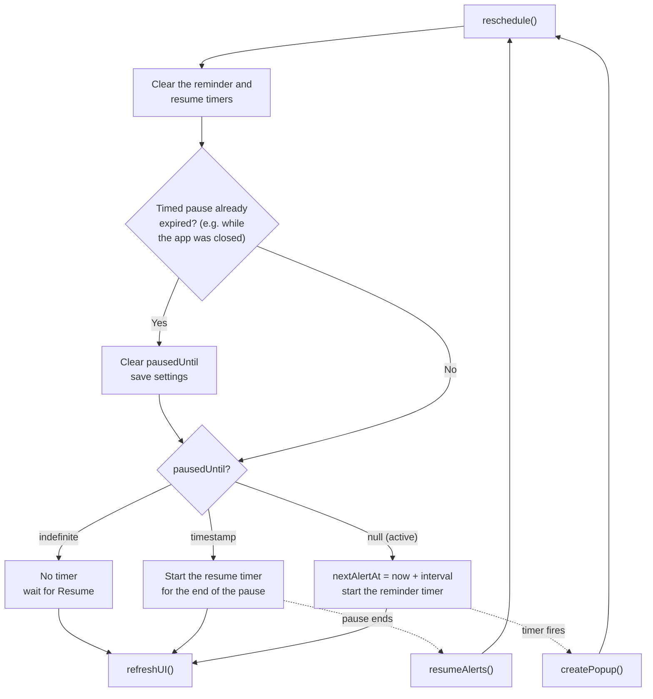

Reminder states and what moves between them:

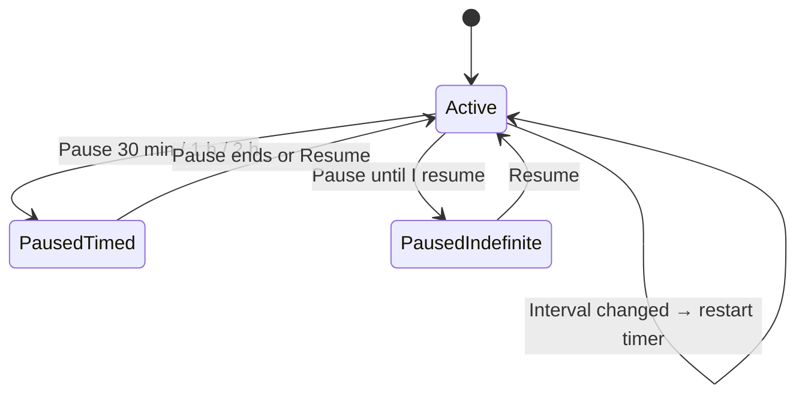

The status shown in the tray, tooltip and settings window is derived from this state:
`Next reminder at 14:30`, `Paused until 15:00`, or `Paused`.

Pause state is saved, so it survives a restart: a timed pause that ended while the app was
closed is cleared at the next start.

---

## 6. Reminder popup

The popup is a small frameless, transparent, always-on-top window. It **never takes focus**,
so it doesn't interrupt your typing, and it closes itself after 6 seconds.

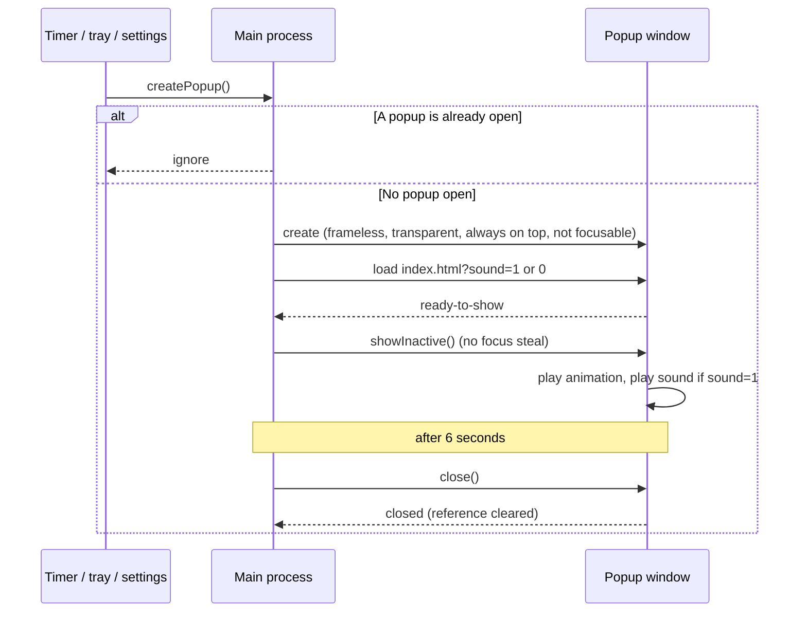

A popup can come from three places: the scheduler, **Show reminder now** in the tray, or the
test button in the settings window.

---

## 7. Settings window and IPC

There is only ever one settings window. Opening it again shows and focuses the existing one.
Closing it **hides** it; the app keeps running in the tray. It's only really destroyed when
you quit.

The window has no OS frame: the page draws its own title bar (drag region, **Minimize** and
**Close to tray** buttons) and asks the main process to resize the window to its content
(`window:fit`), so it grows when the pause menu opens. The countdown ring is updated every
second in the renderer from `nextAlertAt`, without extra IPC.

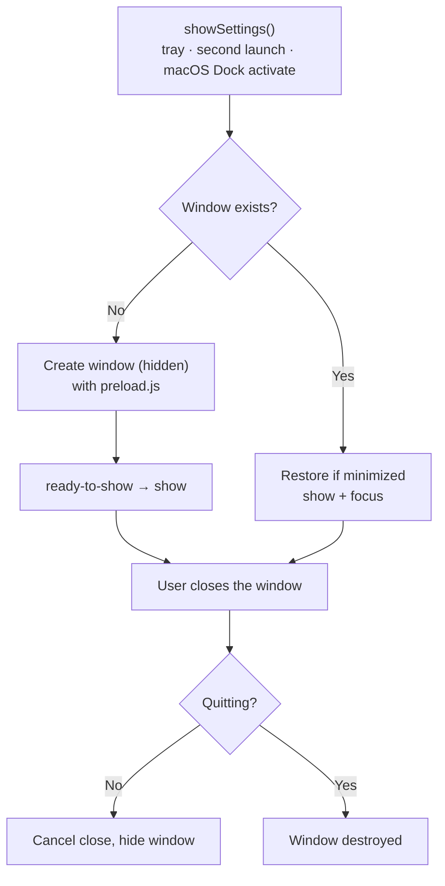

The renderer talks to the main process through request/response IPC channels, and the main
process pushes `state:changed` whenever anything changes, including changes made from the
tray:

| `window.api` function | IPC channel      | Effect                                    |
| --------------------- | ---------------- | ----------------------------------------- |
| `getState()`          | `state:get`      | Returns the current state                 |
| `setSettings(patch)`  | `settings:set`   | `updateSettings(patch)`                   |
| `pause(minutes)`      | `alerts:pause`   | Timed pause, or indefinite when `null`    |
| `resume()`            | `alerts:resume`  | Resume alerts                             |
| `testAlert()`         | `alerts:test`    | Show the popup now                        |
| `minimizeWindow()`    | `window:minimize`| Minimize the settings window              |
| `closeWindow()`       | `window:close`   | Close (hide to tray) the settings window  |
| `fitWindow(height)`   | `window:fit`     | Resize the window to its content height   |
| `onStateChanged(cb)`  | `state:changed`  | Push from main; returns an unsubscribe function |

Example: changing the interval in the settings window.

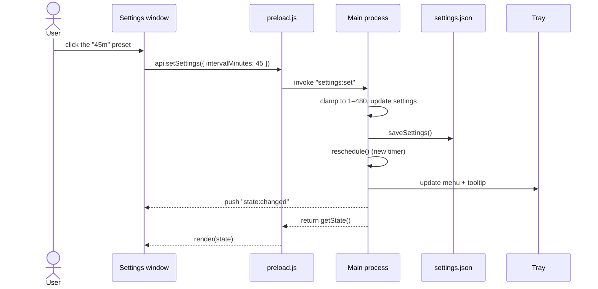

`render(state)` redraws the whole settings UI from the state. It doesn't overwrite the interval
field while you're typing in it, and it re-reads the state every 30 seconds to keep the status
text current.

---

## 8. Tray menu

The menu is rebuilt from the current state after every change.

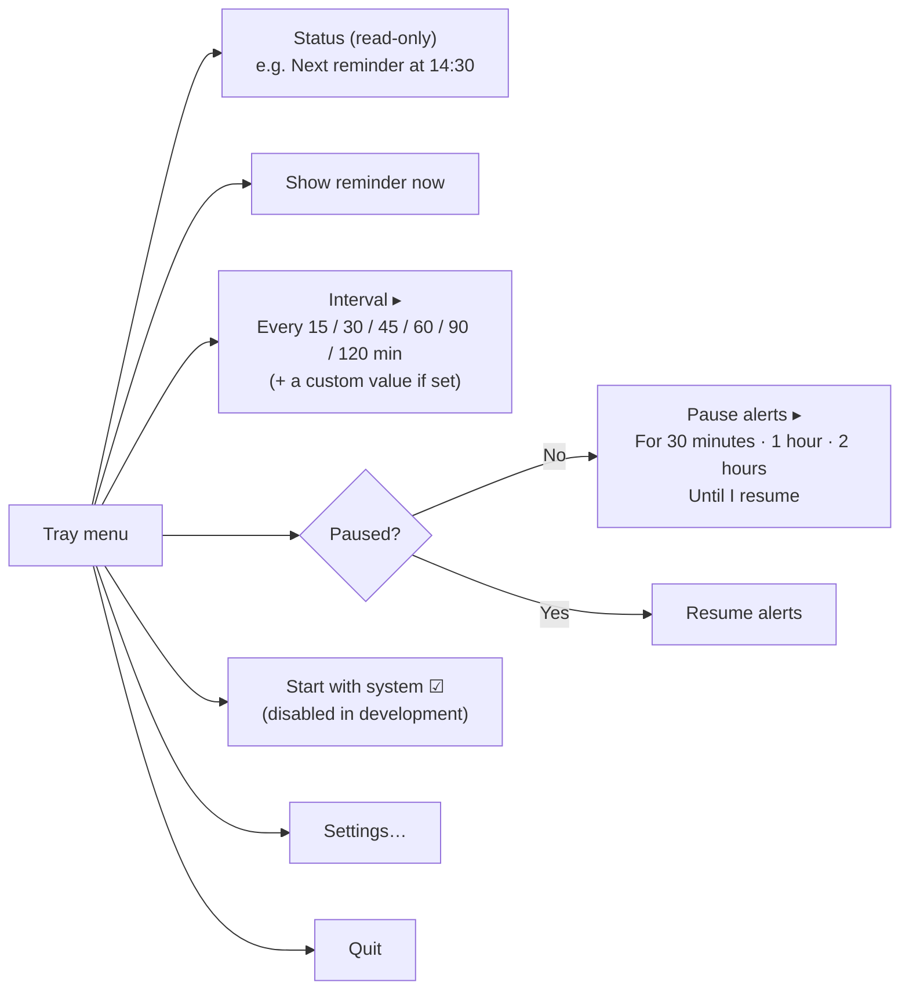

On Windows, left-clicking the tray icon also opens the settings window. The tooltip shows
`Water Reminder — <status>`.

---

## 9. Sleep, wake and quit

Timers don't run reliably while the computer sleeps. On wake, the app restarts the schedule, so
the next reminder comes one full interval after wake, not in a burst.

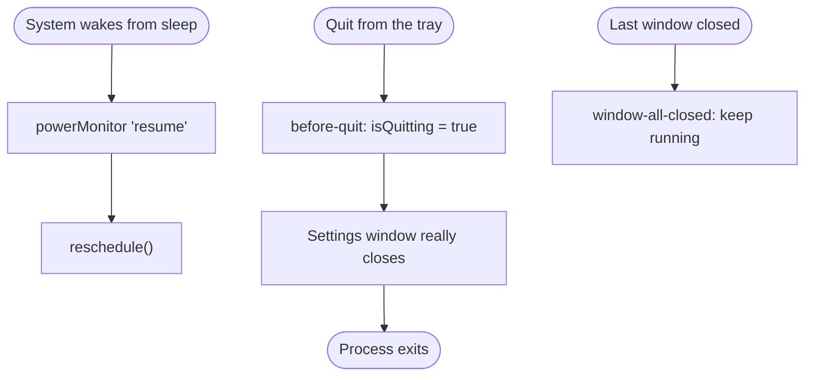

---

## 10. Install and uninstall

| System          | Install                         | Uninstall                                                    |
| --------------- | ------------------------------- | ------------------------------------------------------------ |
| Windows         | NSIS installer (`.exe`), per user, optional install folder, Desktop and Start menu shortcuts, launches when finished | Apps → Installed apps. Also removes the startup entry (`build/installer.nsh`) and app data |
| Linux (`.deb`)  | `sudo apt install ./….deb`      | `sudo apt remove water-reminder`                             |
| Linux (AppImage)| `chmod +x` and run              | Delete the file and `~/.config/autostart/water-reminder.desktop` |
| macOS (`.dmg`)  | Drag to Applications (unsigned: right-click → Open the first time) | Quit and move to Trash        |

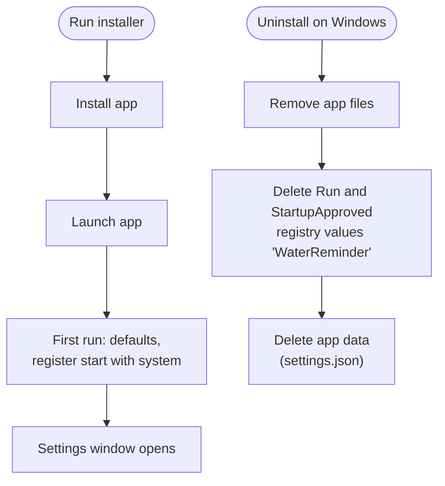

---

## 11. Build and release pipeline

Installers are built by GitHub Actions (`.github/workflows/release.yml`) when a `vX.Y.Z` tag is
pushed. The tag must match `version` in `package.json`.

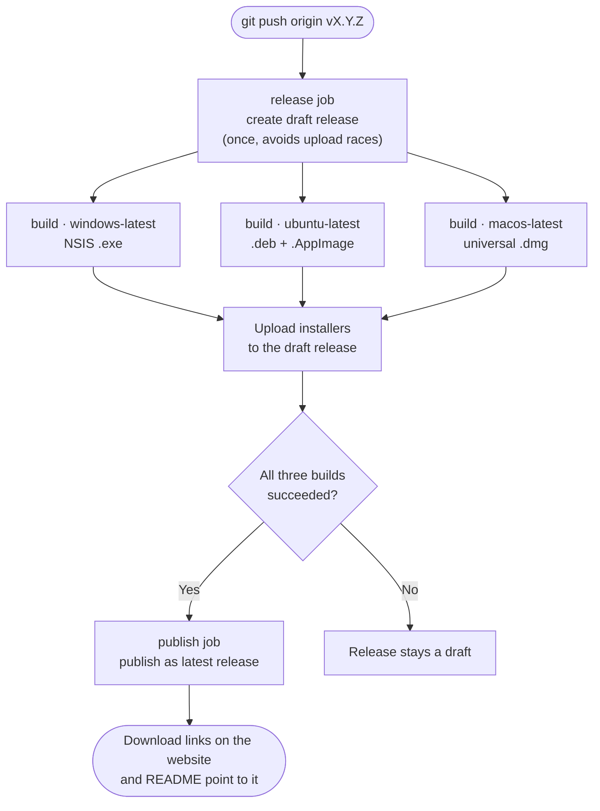

Running the workflow manually from the **Actions** tab skips the release and publish jobs and
only uploads the installers as workflow artifacts.
